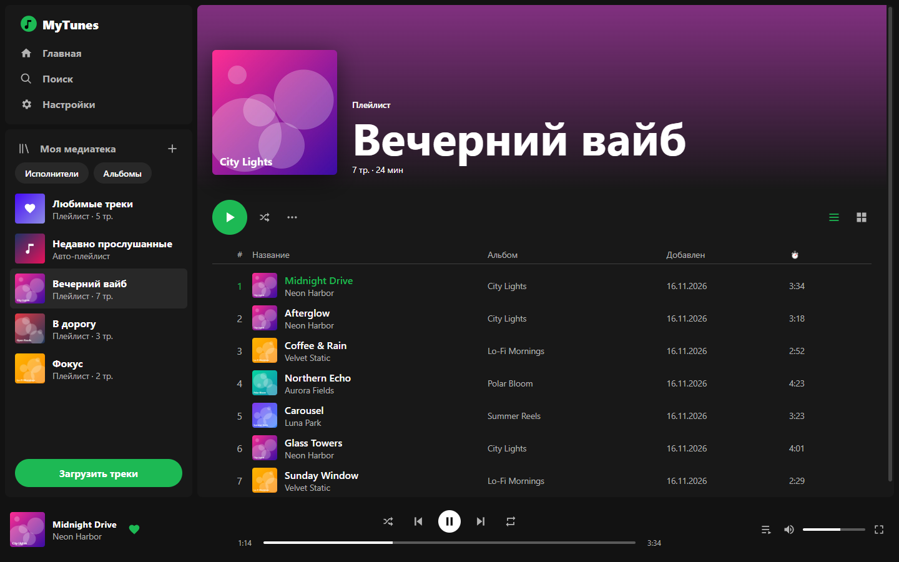
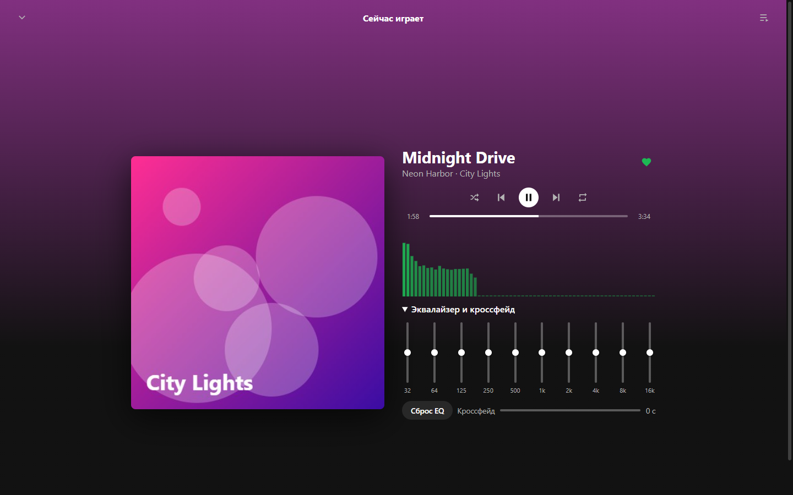
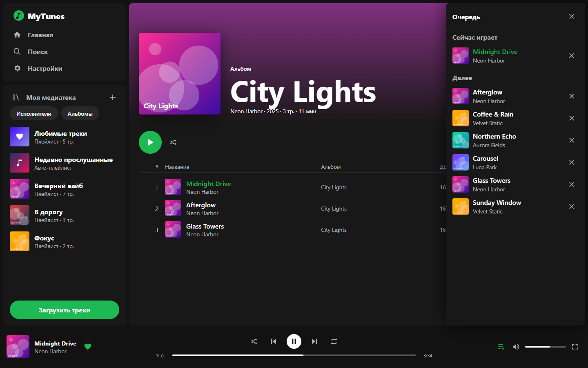
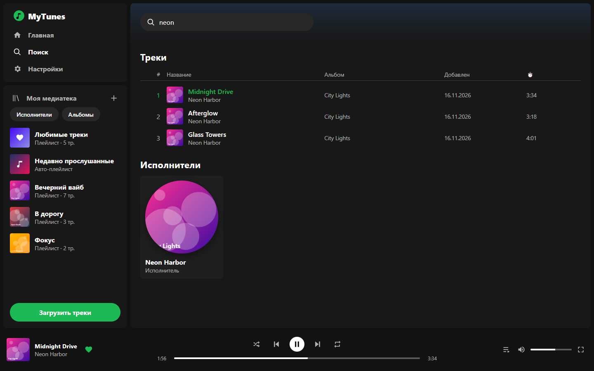
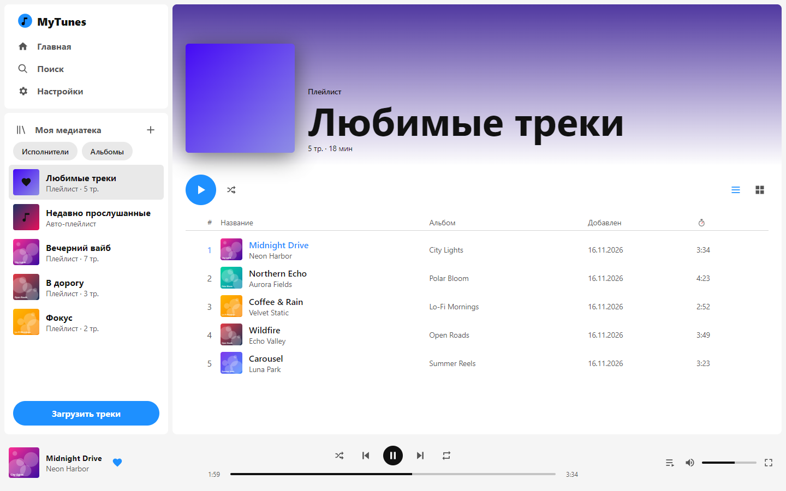
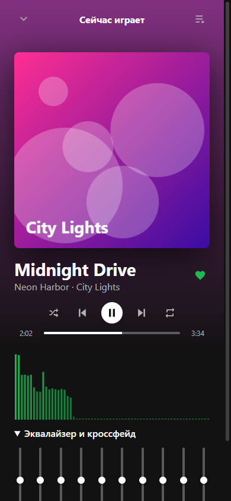

# MyTunes

Локальный музыкальный плеер в одном файле `index.html` (HTML + CSS + JS, без зависимостей) и Windows-приложение на Electron.


## Скриншоты

| Плейлист | Сейчас играет: эквалайзер и визуализатор |
|---|---|
|  |  |
| **Очередь воспроизведения** | **Поиск** |
|  |  |
| **Светлая тема и свой акцент** | **Мобильная версия** |
|  |   |

> Скриншоты сделаны на демо-треках и пересоздаются командой `npm run screenshots`.

## Возможности
- Загрузка своих треков (mp3, wav, ogg, flac, m4a, aac) кнопкой или drag & drop файлов и папок
- Чтение ID3-тегов и обложек, хранение треков в IndexedDB
- Плейлисты, «Любимые треки», исполнители, альбомы, поиск, сортировка, вид списком/сеткой
- Очередь с перетаскиванием, shuffle, repeat, кроссфейд 0–12 с, 10-полосный эквалайзер, визуализатор
- Горячие клавиши, Media Session API, тёмная/светлая тема, выбор акцента, экспорт/импорт JSON

## Запуск в браузере
Откройте `index.html` в Chrome / Edge / Firefox.

## Windows-приложение
```bash
npm install
npm start        # запуск в режиме разработки
npm run dist     # сборка установщика и portable .exe в dist/
```
> Собирайте в папке с коротким путём (например `C:\Projects\MyTunes`): установщик NSIS не работает с путями длиннее 260 символов.

## Горячие клавиши
Пробел — пауза · ←/→ — ±5 сек · Ctrl+←/→ — трек · ↑/↓ — громкость · M — mute · S — shuffle · R — repeat · F11 — полный экран
