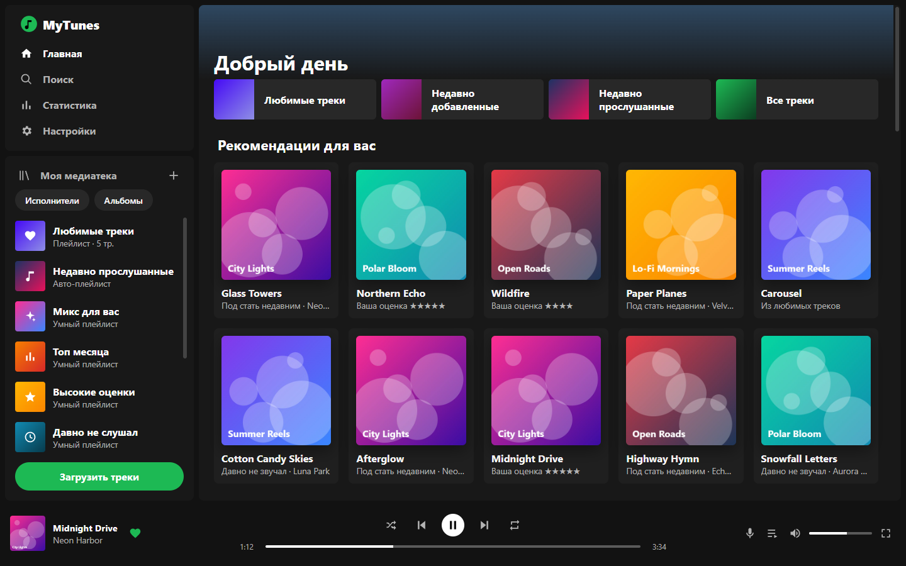
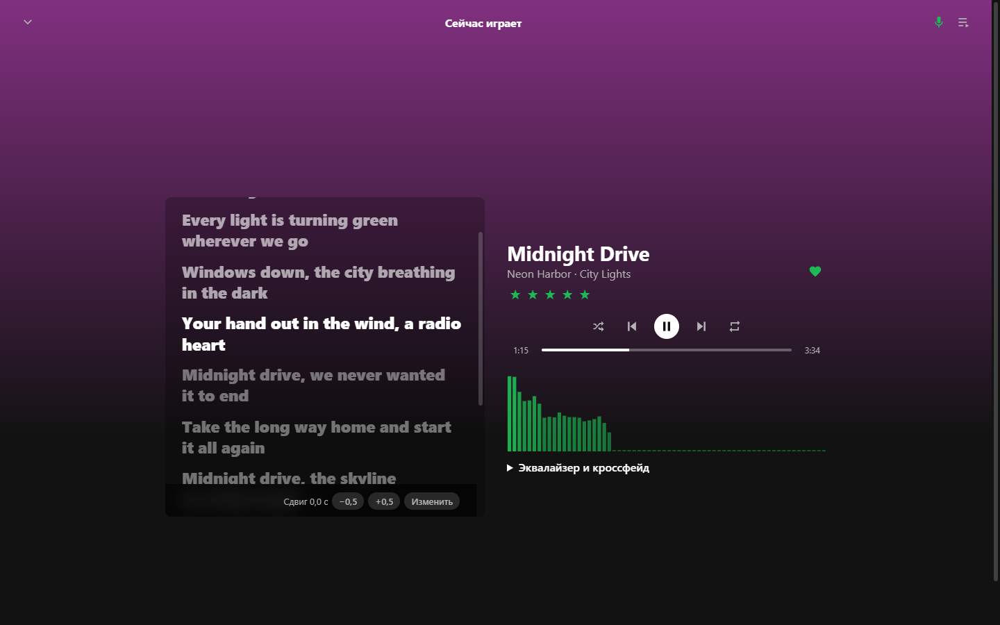
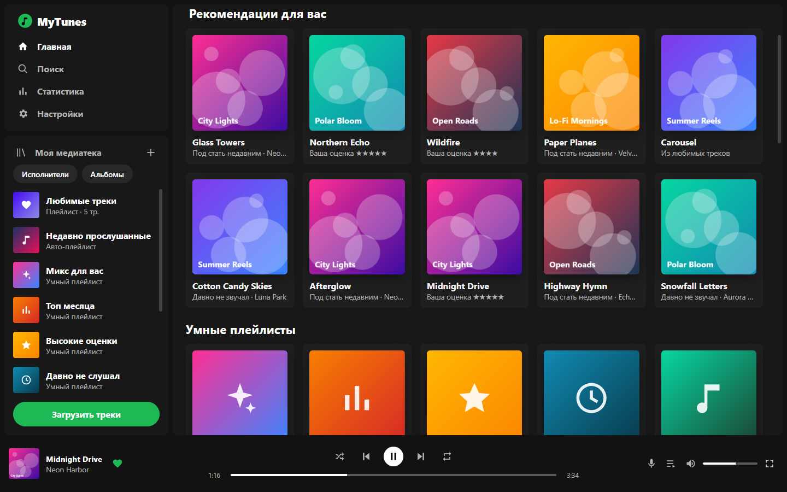
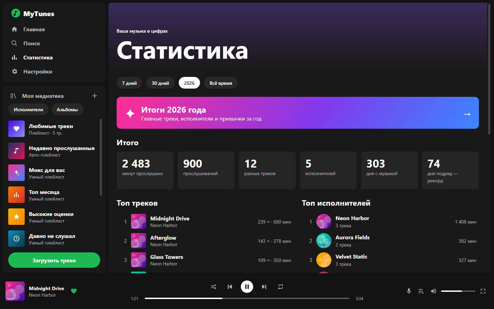
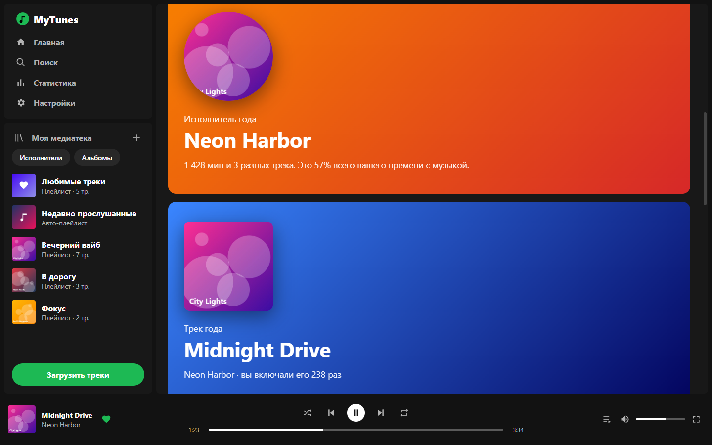
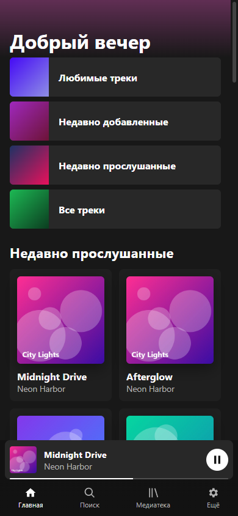

# MyTunes

Локальный музыкальный плеер в одном файле `index.html` (HTML + CSS + JS, без зависимостей), Windows-приложение на Electron и приложение для Android на Capacitor.



## Скриншоты

| Плейлист | Сейчас играет: эквалайзер и визуализатор |
|---|---|
|  |  |
| **Очередь воспроизведения** | **Поиск** |
|  |  |
| **Текст песни с подсветкой строк** | **Рекомендации и умные плейлисты** |
|  |  |
| **Статистика прослушиваний** | **Итоги года** |
|  |  |
| **Светлая тема и свой акцент** | **Мобильная версия** |
|  |   |

> Скриншоты сделаны на демо-треках и пересоздаются командой `npm run screenshots`.

## Возможности
- Загрузка своих треков (mp3, wav, ogg, flac, m4a, aac) кнопкой или drag & drop файлов и папок
- Чтение ID3-тегов и обложек, хранение треков в IndexedDB
- Плейлисты, «Любимые треки», исполнители, альбомы, поиск, сортировка, вид списком/сеткой
- На телефоне: вкладка «Медиатека» → «Создать плейлист»; у исполнителя и альбома — «Сохранить как плейлист» (все его треки одним нажатием)
- Свой порядок треков в плейлистах и «Любимых»: перетаскивание мышью, пальцем за ручку ⠿ или Alt+↑/↓
- Очередь с перетаскиванием (и пальцем на телефоне), shuffle, бесконечный повтор (доиграв, плейлист начинается сначала; при перемешивании — в новом порядке), кроссфейд 0–12 с, 10-полосный эквалайзер, визуализатор
- Тексты песен: из тегов (ID3 USLT, FLAC LYRICS), из `.lrc` рядом с треком или поиском в открытой базе lrclib.net; синхронизированные строки подсвечиваются, клик по строке — перемотка
- Склейка треков без пауз: следующий трек загружается заранее, внутри альбома — встык без кроссфейда
- Умное перемешивание: случайный порядок без одного исполнителя и альбома подряд, любимые треки звучат раньше, недавние и с оценкой 1★ — позже
- Оценки 1–5 звёзд, «Радио» по треку, рекомендации и умные плейлисты: «Микс для вас», «Топ месяца», «Высокие оценки», «Давно не слушал», «Никогда не играл»
- Полный перенос медиатеки: резервная копия в один .zip (треки, обложки, плейлисты, оценки, тексты, история) и синхронизация по Wi‑Fi между компьютером и телефоном — по QR-коду или вручную по адресу и коду
- Статистика прослушиваний (топы, минуты, графики по часам/дням/месяцам) и «Итоги года»
- Горячие клавиши, Media Session API, тёмная/светлая тема, выбор акцента, экспорт/импорт JSON

## Синхронизация компьютера и телефона
1. На компьютере: Настройки → «Синхронизация с телефоном» → «Включить синхронизацию». Появится QR-код. Включённая синхронизация запоминается и стартует вместе с MyTunes.
2. На телефоне: Ещё → «Сканировать QR-код». Это нужно сделать один раз.

Дальше телефон синхронизируется сам — при запуске, при возврате в приложение и каждые 10 минут, если MyTunes на компьютере открыт и оба устройства в одной Wi‑Fi сети. В обе стороны переносятся треки, плейлисты (название, состав, порядок, удаление), любимые, оценки, тексты и история; при расхождении побеждает более позднее изменение. Трек, удалённый на телефоне, на компьютере остаётся и заново не скачивается. «Сменить ключ» на компьютере отвязывает все телефоны.

## Демо-версия
 (или , или  в браузере) — отдельная медиатека с треками-пустышками: 16 треков пяти выдуманных исполнителей, музыка синтезируется приложением, обложки рисуются, есть оценки, плейлисты, текст песни и история прослушиваний за год. Настоящая медиатека не видна и не меняется; демо можно запускать рядом с обычной MyTunes. Пересоздать — Настройки → «Пересоздать демо». Сборка: .

## Запуск в браузере
Откройте `index.html` в Chrome / Edge / Firefox.

## Windows-приложение
```bash
npm install
npm start        # запуск в режиме разработки
npm run dist     # сборка установщика и portable .exe в dist/
```

- **Открыть с помощью MyTunes.** Установщик регистрирует MyTunes для mp3, flac, wav, ogg, m4a, aac. Чтобы файлы открывались двойным кликом, выберите MyTunes в «Открыть с помощью → Всегда». Файл добавляется в медиатеку (вместе с `.lrc` рядом) и сразу играет.
- **Автообновление.** Установленная версия сама проверяет релизы на GitHub, скачивает обновление в фоне и предлагает перезапуститься. Переносная версия сообщает о новой версии и даёт ссылку на скачивание.
> Собирайте в папке с коротким путём (например `C:\Projects\MyTunes`): установщик NSIS не работает с путями длиннее 260 символов.

## Android
Скачайте `MyTunes-1.x.x.apk` из [релизов](https://github.com/KnpSrb/mytunes/releases) и установите (Android 7.0+, понадобится разрешить установку из этого источника).

- Музыка играет в фоне и при выключенном экране, управление — из уведомления и с экрана блокировки.
- Треки добавляются кнопкой «Выбрать файлы» (mp3, flac, ogg, m4a, wav, aac, ZIP).
- **Синхронизация с компьютером по QR-коду:** в MyTunes на компьютере — Настройки → «Перенос по Wi‑Fi» → «Включить перенос», появится QR-код. На телефоне — Ещё → «Сканировать QR-код» (или отсканировать системной камерой: ссылка `mytunes://sync` откроет MyTunes). Синхронизация начнётся сама: недостающие треки скачаются на телефон, а треки с телефона отправятся на компьютер. Плейлисты, любимые, оценки, тексты и история объединяются, уже имеющиеся треки не дублируются. Без камеры — введите адрес и код вручную; есть кнопки «Только скачать оттуда» и «Только отправить туда».
- Новые версии приложение проверяет само и предлагает скачать APK.

Сборка (нужны Android SDK и JDK 21):
```bash
npm run android:sync   # копирует index.html в www/ и обновляет android/
npm run android:apk    # android/app/build/outputs/apk/release/app-release.apk
npm run icons          # перерисовать иконки (build/icon.ico, mipmap-*) из scripts/icons.js
```
Ключ подписи хранится вне репозитория: `%USERPROFILE%.mytunes-keyskeystore.properties` (или путь в `MYTUNES_KEYSTORE`). Обновления APK устанавливаются поверх только с тем же ключом — храните его копию.

## Горячие клавиши
Пробел — пауза · ←/→ — ±5 сек · Ctrl+←/→ — трек · ↑/↓ — громкость · M — mute · S — shuffle · R — repeat · L — текст песни · 1–5 — оценка, 0 — снять · F11 — полный экран
